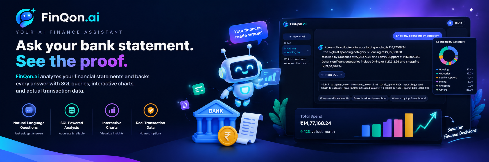

# FinQon.ai

Plain-English questions over your bank statement.  
The answer, the SQL, the chart, and the rows — from the same query.

[Start](#start) · [Walkthrough](#product-walkthrough) · [Text to SQL](#text-to-sql) · [Statement RAG](#statement-rag) · [Schema](#schema) · [Stack](#stack)

---

You ask a question. A small FastAPI agent writes a `SELECT`, PostgreSQL runs it under a read-only role, and the React desk plots those rows. Numbers in the reply have to come from the result. A second path searches your uploaded statement by meaning, using embeddings stored next to each transaction. 

---

## Start

You need Python 3.12, Node 20+, a Neon Postgres project (pgvector enabled), and an OpenAI-compatible API key.

```bash
cp .env.example .env     # fill the four database URLs, JWT secret, and model key
```

Use Neon **direct (session)** URLs, not the transaction pooler. `set_config` for row-level security has to stay on the same connection as the query.

### Backend

```bash
cd backend
python3 -m venv .venv && source .venv/bin/activate
pip install -e ".[dev]"

python -m finqon.db.bootstrap_roles   # finqon_api, finqon_reader, finqon_loader
alembic upgrade head                  # schemas, RLS, views, uploads, embeddings
python ../dataset/load_ledger.py      # two seed users

uvicorn finqon.main:app_factory --factory --reload
```

API at `http://localhost:8000`. Docs at `/docs`. `GET /health` returns `{"status":"ok"}`.

### Frontend

The API must already be on port 8000. Vite proxies `/api` and `/health`.

```bash
cd frontend
npm install
npm run dev          # http://localhost:5173
```

### Docker

The database stays on Neon. Compose runs the API and the built UI.

```bash
docker compose --profile setup run --rm setup    # once: roles, migrations, seed
docker compose up --build api web                # API :8000, UI :5173
```


| Service | What it does                                                                       |
| ------- | ---------------------------------------------------------------------------------- |
| `api`   | Production image. Read-only filesystem, no extra capabilities.                     |
| `web`   | Built React app. Proxies `/api` to the API container.                              |
| `setup` | One-off. Needs `FINQON_ADMIN_DATABASE_URL`. Safe to run again.                     |
| `eval`  | `docker compose --profile eval run --rm eval` writes `eval/reports/latest.md`.     |
| `test`  | `docker compose --profile test run --rm test` runs pytest, including the database. |


### First question

Sign in as the seed user (`kalpeshpawar@gmail.com`, password is `FINQON_SEED_PASSWORD`) and ask:

> How much did I spend on eating out last month?

Or skip the browser:

```bash
finqon-cli reference --user kalpeshpawar@gmail.com
finqon-cli ask "How much did I spend on eating out last month?" --user kalpeshpawar@gmail.com
```

`reference` runs the known-good query and needs no model key. `ask` runs the full agent. “Last month” is resolved in `Asia/Kolkata`, so the rupee figure moves with the calendar. The seed rows do not.

---

## Product walkthrough

1. **Land.** Dark full-viewport page. The call to action opens the auth card.
2. **Sign in or register.** Same card, same fields. Access token stays in memory. Refresh token is stored and rotated on each use.
3. **Open the desk.** History on the left, the thread in the middle, evidence on the right.
4. **Ask.** Status steps run `thinking → querying → summarizing`. Tokens stream only after the answer is checked.
5. **Read the evidence.** Show SQL, switch Bar / Pie / Line, scroll the table. The chart is plotted from `table.rows`, never from the sentence.
6. **Follow up.** “What about the month before?” stays in the same conversation. The model sees the previous SQL and a one-line summary, not the old rows.
7. **Upload a statement.** Paperclip or drop a CSV, XLSX, or text PDF. The job parses, reconciles, classifies, embeds, and imports. Then ask about that file the same way.

Under 1120px the history becomes a drawer. Under 800px the evidence panel follows the answer.

---

## Text to SQL

```
Browser
  │  POST /api/v1/chat   Bearer JWT
  ▼
FastAPI  ──►  ChatService  ──►  agent loop  ◄──►  LLM
                                    │
                                    │  run_sql_query
                                    ▼
                              sqlglot guard
                              SELECT only · 3 views · LIMIT ≤ 500
                                    │
                                    ▼
                              finqon_reader
                              read-only · 5s timeout · finqon.user_id
                                    │
                                    ▼
                              Neon Postgres + RLS
                                    │
                                    ▼
                         SSE: status · sql · table · chart · token · done
```

The loop is capped at 6 model steps, 3 SQL runs, 2 repairs, and 30 seconds.


| Tool                  | Job                                                                               |
| --------------------- | --------------------------------------------------------------------------------- |
| `run_sql_query`       | One guarded `SELECT`. Returns columns, a row sample, and numeric min / max / sum. |
| `search_transactions` | Semantic search over uploaded and seeded narrations. See below.                   |
| `search_merchants`    | Typo-tolerant merchant match (`pg_trgm`) limited to merchants this user has used. |
| `ask_clarification`   | At most three options when the question is ambiguous. No SQL is run.              |


The model never receives the full result. After a query it sees the columns, the row count, the first 20 rows, and aggregates. Every number and ISO date in the draft must appear in that payload, the question, or the SQL. One mismatch triggers a single rewrite. A second mismatch becomes a fixed refusal.

Dates such as “last month” and “this quarter” are computed in Python and placed in the prompt. The model does not invent the calendar.

A destructive request has to pass five independent layers: the prompt, the sqlglot guard, the `finqon_reader` role (`NOSUPERUSER NOBYPASSRLS`), forced row-level security, and the grounding check. The guard rejects `set_config`, `current_setting`, and `pg_*`, so model SQL cannot read or change who the user is.

---

## Statement RAG

Upload is not a separate chat. A file becomes rows in the same ledger the SQL agent already reads, plus a vector on each narration.

```
CSV · XLSX · text PDF
        │
        ▼
  hash + validate          10 MB · 5 files · magic-byte check
        │
        ▼
  ledger.statements        queued job, polled by GET /api/v1/files
        │
        ├─ parse
        ├─ reconcile running balance     mismatch → quarantine, nothing imported
        ├─ classify                      alias table, then keyword rules
        ├─ mask PII in the narration
        ├─ embed raw_description         gemini-embedding-001 · 768 dims
        └─ insert transactions           RLS applies immediately
                │
                ▼
        search_transactions
        pgvector  ⊕  pg_trgm
        fused with reciprocal rank fusion
                │
                ▼
        same evidence panel as a SQL answer
```

Re-uploading the same bytes returns the existing job. Embeddings that were missed at import can be filled later:

```bash
finqon-cli embed-backfill
```

If the embedding call fails during a question, lexical search still runs. The turn is not failed.

Bytes stay in memory for the job. There is no object store and no scanned-PDF OCR.

---

## Data and schema decisions

Synthetic statements, fixed seed `20260101`, window **1 April – 21 October 2026**. The primary user has **538 transactions** (six months, 500+). A second user exists only so row-level security can be tested. Load path: `generate_ledger.py` → `normalize_descriptions.py` → `load_ledger.py`.


| Decision                    | What we did                                                                                                                                                                                            |
| --------------------------- | ------------------------------------------------------------------------------------------------------------------------------------------------------------------------------------------------------ |
| Debits and credits          | `amount` is always positive. `direction` is `debit` or `credit`. No signed amount on the raw row.                                                                                                      |
| Spend                       | A debit that is not a transfer, minus linked refunds. Salary and other credits are not spend.                                                                                                          |
| Refunds                     | A credit with `refund_of_txn_id` pointing at the purchase. It is **negative spend on the day it arrives**, not back-dated onto the purchase month.                                                     |
| Transfers                   | Kept on `reporting.transactions` (so “sent home” is answerable) and excluded from `reporting.spend`.                                                                                                   |
| Messy narrations            | Raw text stays in `raw_description` (`UPI-SWIGGY…`, NEFT, IMPS, card strings).                                                                                                                         |
| Clean merchant and category | Lookup table `ledger.merchant_aliases`, then keyword rules. Optional `--use-llm` only for rows that still match nothing, and the answer is written back as an alias.                                   |
| Unknown merchants           | Become `Unknown Merchant` / `Uncategorised`. Rankings leave them out. We do not guess.                                                                                                                 |
| What the model reads        | Three views, not the base tables: `reporting.transactions`, `reporting.spend`, `reporting.monthly_category_spend`. They already join merchant and category and expose `fy`, `fy_quarter`, and `month`. |
| Comments                    | Every view and column has a Postgres `COMMENT`. The prompt is built from those comments.                                                                                                               |
| Calendar                    | Financial year 1 April–31 March. Dates in `Asia/Kolkata`.                                                                                                                                              |
| Recurring payments          | Salary, EMI, rent-like transfers, fees, and subscriptions are real rows on fixed days, not a separate table.                                                                                           |


Five schemas: `identity`, `ledger`, `conversation`, `operations`, `reporting`. Alembic is the only way they change. The signed column the model should use for “how much did I spend?” is `spend_amount`.

---

## Stack


| Layer      | Choice                                                              |
| ---------- | ------------------------------------------------------------------- |
| Frontend   | React, TypeScript, Vite, Tailwind CSS                               |
| Backend    | Python, FastAPI                                                     |
| Database   | PostgreSQL on Neon, Alembic                                         |
| LLM        | Gemini (`gemini-flash-latest`) through the OpenAI SDK               |
| Agent      | Hand-rolled tool loop.                                              |
| SQL safety | sqlglot guard, read-only role, row-level security                   |
| Search     | pgvector and `pg_trgm`                                              |
| Packaging  | Docker Compose for the API and the frontend. Database stays on Neon |


---

## Environment

Settings use the `FINQON_` prefix and are read from the environment or the root `.env`. A missing required value stops startup and names the variable. It never prints the value.


| Variable                     | Who needs it                                              |
| ---------------------------- | --------------------------------------------------------- |
| `FINQON_API_DATABASE_URL`    | API role `finqon_api`                                     |
| `FINQON_READER_DATABASE_URL` | Role `finqon_reader`, model SQL                           |
| `FINQON_LOADER_DATABASE_URL` | Seed loader                                               |
| `FINQON_ADMIN_DATABASE_URL`  | Bootstrap and Alembic only                                |
| `FINQON_SEED_PASSWORD`       | The two seed users                                        |
| `FINQON_JWT_SECRET`          | At least 32 characters                                    |
| `FINQON_LLM_API_KEY`         | Real answers and the eval                                 |
| `FINQON_LLM_BASE_URL`        | Optional. Defaults to Gemini’s OpenAI-compatible endpoint |
| `FINQON_LLM_MODEL`           | Optional. Defaults to `gemini-flash-latest`               |
| `FINQON_CORS_ORIGINS`        | Optional. Default `http://localhost:5173`                 |
| `FINQON_TIMEZONE`            | Optional. Default `Asia/Kolkata`                          |


---

## Check your work

```bash
make check          # lint, types, unit tests
make test           # integration tests too, when the database URLs are set

python eval/run_eval.py --reference-only    # reference SQL, no model
python eval/run_eval.py                     # full set → eval/reports/latest.md
```

The eval compares result values, not SQL text. Numbers must match within ₹0.01. Failures stay in the report. The fix belongs in the views, the date preamble, or the examples, not in the question text.

`GET /health` is liveness. `GET /health/ready` checks both database pools and returns 503 if either is down.

---

## Also worth knowing

- **Answers are verified before they stream.** Model output is buffered, grounded, then emitted as `token` events. Unchecked figures never reach the screen.
- **History does not store rows.** A refresh shows the question and the answer. The chart returns on the next question in that chat.
- **Refresh tokens are families.** Reuse of an old token revokes the whole family. Logout is idempotent.
- **Register and login are rate limited in process** (10 attempts per minute). One API instance is the supported shape. Several replicas need a shared limiter, which this project does not add.
- **PII in narrations is masked on import** before the text is stored, embedded, or shown to the model.
- **Seed data is synthetic** and generated from a fixed random seed. Do not point this at a real statement in a shared environment without reviewing the privacy path.
- **Deeper design notes** live in [docs/architecture.md](docs/architecture.md). The seed ledger is described in [dataset/README.md](dataset/README.md).

