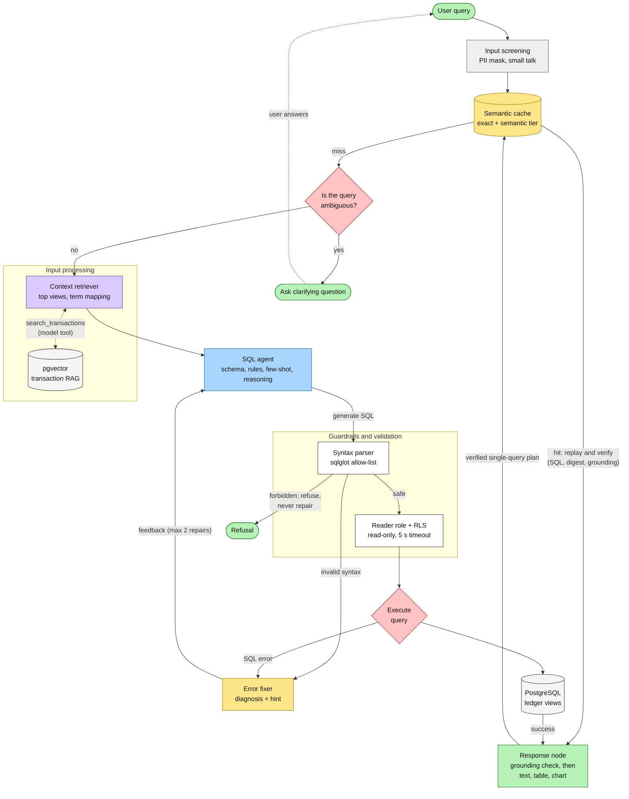

# FinQon.ai Agent Architecture

## Enterprise pipeline: cache, ambiguity gate, context retriever, SQL agent, guardrails, error fixer, grounded response

Each stage is its own module with one job, a fixed contract, and its own tests. The model is
called in exactly two stages (the SQL agent and the response), and the deterministic stages
around it remove model calls, constrain it, or check it.



Colours follow the reference diagram: green is what the user sees, yellow is cache and
repair, pink is a decision, purple is retrieval, blue is the model that writes SQL.

### Where each box lives

| Box | Module | Model call | Deterministic |
| --- | --- | --- | --- |
| Input screening | `privacy/pii.py`, `agent/smalltalk.py`, `services/chat.py:gate_message` | no | yes |
| Semantic cache | `cache/` (see `docs/semantic-cache.md`) | no (an embedding for the semantic tier) | yes |
| Is the query ambiguous? | `agent/ambiguity.py` | no | yes |
| Ask clarifying question | `orchestrator._preflight_clarification`, `ask_clarification` tool | no / the model may also call the tool | yes / no |
| Context retriever | `agent/context.py`, `prompt_builder.py` | no | yes |
| Vector DB (RAG) | `search_transactions` tool, `sql/executor.py`, pgvector + pg_trgm | an embedding | yes |
| SQL agent | `orchestrator.py`, `prompt_builder.py`, `few_shot_examples.py`, `llm/client.py` | **yes** | no |
| Guardrails: syntax parser | `sql/guard.py` | no | yes |
| Guardrails: RLS | `sql/executor.py` (reader role) plus PostgreSQL policies | no | yes |
| Execute query / DB | `sql/executor.py` | no | yes |
| Error fixer | `agent/error_fixer.py`, `orchestrator._repair_payload` | no | yes |
| Response node | `orchestrator.py`, `agent/grounding.py`, `services/chat.py` | **yes** | the check is |

### Stage contracts

| Stage | Input | Output | On failure |
| --- | --- | --- | --- |
| Semantic cache | question, user, ledger and schema fingerprint | verified replay, or a miss | Any error reads as a miss |
| Ambiguity gate | question, history, previous SQL, category names | a clarification (question and at most 3 options), or nothing | Cannot fail; no match means the agent proceeds |
| Context retriever | question, schema catalog, `top_k` | ranked views and `"phrase" -> schema` mappings, as a prompt section | A mapping whose category or column is not in the live catalog is dropped |
| SQL agent | system prompt, question | `run_sql_query`, `search_merchants`, `search_transactions` or `ask_clarification` calls, then the answer | Model errors become an `error` event |
| Guardrails | generated SQL | guarded SQL with a row cap, or a `SqlGuardError` | Forbidden: refuse. Syntax: error fixer |
| Execution | guarded SQL, user id | rows, or `QueryExecutionError` | Error fixer |
| Error fixer | error text, the SQL, catalog | the original error plus a `hint` and a stable `kind` | No matching rule: the original error alone |
| Response node | tool results, drafted answer | streamed answer, or a regeneration, then a refusal | Unverified figures are never shown |

### What the new stages do

**Ambiguity gate.** Two rules, both of which would otherwise force the model to guess:

1. A quarter with no year kind ("Q3"). Financial and calendar quarters never coincide here, so
   the user is asked: *Which Q3 do you mean?* with `Financial-year Q3 (Oct-Dec)` and
   `Calendar Q3 (Jul-Sep)`. Any wording that settles it ("financial", "fiscal", "calendar",
   "FY26") skips the question, and a choice made earlier in the conversation carries over.
2. A follow-up fragment ("and last month?") in a conversation with nothing to follow up.

It runs after the cache lookup (as in the reference diagram) and before the model, so asking
costs no tokens and the answer cannot be forgotten by the model. The model can still call
`ask_clarification` for anything else, under rules 8 and 9 of the prompt. The event and the
stored message are identical either way, so the UI needs no change: the options appear as
buttons and the click is the next message.

**Context retriever.** Ranks the views for the question (name, comments, columns, and what
each view is for) and keeps the best `FINQON_AGENT_CONTEXT_TOP_VIEWS`. It maps the user's
words to schema entities, for example `"eating out" -> category_name = 'Dining'` and
`"salary" -> category_name = 'Salary' (income: not in reporting.spend, use
reporting.transactions)`, which is the reference diagram's "Apple means comp_name". Hints are
validated against the live catalog and labelled as hints; the schema in the prompt stays
authoritative.

**Error fixer.** When SQL fails, the model receives the original error unchanged and a hint:

```json
{"error": "column \"amt\" does not exist",
 "instruction": "Fix the SQL and try again.",
 "hint": "There is no column 'amt'. Closest columns in the schema: spend_amount (reporting.spend)."}
```

Rules cover unknown columns and views (with did-you-mean from the catalog, including
abbreviations such as `amt`), division by zero, `GROUP BY` and aggregate-in-`WHERE` mistakes,
ambiguous columns, type mismatches, bad literals, unknown functions, timeouts and syntax
errors. It never edits SQL: the model rewrites it and the guard validates the rewrite as
usual, so this stage cannot widen what may run.

### Where this differs from the reference diagram, on purpose

| Reference | FinQon | Why |
| --- | --- | --- |
| "unsafe" goes to the error fixer | Forbidden SQL (writes, other tables, denied functions) is refused and never repaired; only syntax and execution errors are fixed | Helping a model that tried to escape the allow-list is a security hole, not a repair |
| RLS is a step after the parser | RLS is enforced by PostgreSQL for the reader role on every query | A check in application code can be bypassed by a bug; the database cannot |
| Retrieve top 5-10 tables from a vector DB | Rank views by keywords and intent; the vector index serves transaction search | There are three reporting views, and a keyword rank is exact and free at that size. The `retrieve_context` signature is the seam for a vector-ranked schema retriever |
| One-shot or few-shot, chain of thought | Few-shot examples validated by the guard in tests; reasoning stays inside the model | No hidden reasoning text is stored or shown |

### Limits (unchanged by the new stages)

```
MAX_MODEL_STEPS = 6   MAX_SQL_EXECUTIONS = 3   MAX_REPAIRS = 2
GROUNDING RETRY = 1   DEADLINE_SECONDS = 30
```

The gate and the retriever add no model steps. A clarification ends the turn with zero model
calls. The error fixer's hints make each repair more likely to succeed within the same budget.

### Configuration

| Setting | Default | Effect |
| --- | --- | --- |
| `FINQON_AGENT_CLARIFY_BEFORE_MODEL` | `true` | `false` leaves every clarification to the model |
| `FINQON_AGENT_CONTEXT_TOP_VIEWS` | `5` | Views in the prompt. With three views the whole schema is always sent, ranked |
| `FINQON_CACHE_MODE` | `off` | The semantic cache in front of all stages |

### Observability

| Log event | Fields | Use |
| --- | --- | --- |
| `agent_preflight_clarification` | `reason` (`quarter_year_kind`, `dangling_follow_up`) | How often the gate asks, and why |
| `agent_sql_error` | `kind` (`unknown_column`, `syntax`, `timeout`, ...) | Which SQL mistakes the model makes; feed the common ones into the prompt or examples |
| `semantic_cache_turn`, `semantic_cache_shadow` | see `docs/semantic-cache.md` | Cache hit rate and safety |

Neither new event carries SQL text, question text or user ids.

### How to verify the new stages

```bash
make test-unit                              # tests/unit/test_agent_stages.py: 52 tests, no services
make eval                                   # live model; the ambiguous-quarter case is now deterministic
curl -N -H "Authorization: Bearer $TOKEN" -H 'Content-Type: application/json' \
  -d '{"message": "How much did I spend in Q3?"}' localhost:8000/api/v1/chat
# expect: a clarification event with two options, then done. No sql, table or token events.
docker compose logs api | grep -E 'agent_(preflight_clarification|sql_error)'
```

### Known gaps

* Schema retrieval is keyword and intent based. It is exact for three views and will need the
  vector-ranked retriever when the catalog grows to dozens of views.
* The gate has two rules. More ambiguity types (for example "last year" meaning financial or
  calendar) should be added only with eval evidence that a default is wrong often enough.
* The error fixer's effect on repair success has not been measured against the live model.
  Run `make eval` and compare steps and refusals before and after, and watch `agent_sql_error`.
* Term mappings are a static English glossary; merchant names are resolved by the
  `search_merchants` tool, not by the retriever.

## Inner loop detail

The rest of this file describes the SQL agent, guardrail, execution and response stages in
detail. The model uses native function calling (not text-based "Thought/Action" ReAct), and
the loop is written by hand. Example values and payloads are illustrative. In the diagrams
below, STEP 1 also receives the retrieved context for the question, and a failed STEP 4 or
execution passes through the error fixer before the model sees it.

```
╔═══════════════════════════════════════════════════════════════════════════════╗
║                        FINQON.AI AGENT ARCHITECTURE                          ║
║                (Hand-rolled tool-calling loop + verifier)                    ║
╚═══════════════════════════════════════════════════════════════════════════════╝


                                USER QUESTION
                                     │
                                     ▼
        ┌────────────────────────────────────────────────────┐
        │         TURN INPUT (TurnInput)                     │
        ├────────────────────────────────────────────────────┤
        │ • question: "How much did I spend on dining?"      │
        │ • user_id: UUID (from JWT token)                  │
        │ • conversation_id: UUID                            │
        │ • today: date (Asia/Kolkata)                      │
        │ • history: [previous_turns]                        │
        │ • previous_sql: string | None                     │
        └────────────────────────────────────────────────────┘
                                     │
                                     ▼
        ╔════════════════════════════════════════════════════╗
        ║  STEP 1: BUILD SYSTEM PROMPT                       ║
        ║  (prompt_builder.py)                               ║
        ╚════════════════════════════════════════════════════╝
                                     │
              ┌──────────────────────┼──────────────────────┐
              ▼                      ▼                      ▼
        ┌─────────────┐      ┌──────────────┐      ┌────────────┐
        │ INSTRUCTIONS│      │ SCHEMA DOCS  │      │ FEW-SHOT   │
        │ (role,      │      │ (from DB     │      │ EXAMPLES   │
        │  task,      │      │  catalog)    │      │ (Q&A       │
        │  safety)    │      │ • columns    │      │  pairs)    │
        │             │      │ • views      │      │            │
        │ "You are an │      │ • comments   │      │ "Q: Total  │
        │ analyst...  │      │              │      │ spend for  │
        │ Use only    │      │ reporting.   │      │ August?    │
        │ these 3     │      │ transactions │      │            │
        │ views..."   │      │ reporting.   │      │ A: 45,000  │
        │             │      │ spend        │      │ (SQL...)"  │
        │             │      │ reporting.   │      │            │
        │             │      │ monthly...   │      │            │
        └─────────────┘      └──────────────┘      └────────────┘
              │                      │                      │
              │              ┌────────┴────────┐            │
              │              ▼                 ▼            │
              │         ┌────────────────────────┐          │
              │         │ DATE RANGES            │          │
              │         │ (date_ranges.py)       │          │
              │         ├────────────────────────┤          │
              │         │ "last month" =         │          │
              │         │  July 1-31, 2026       │          │
              │         │ "this quarter" =       │          │
              │         │  Jul 1 - Sep 30        │          │
              │         └────────────────────────┘          │
              │                      │                      │
              └──────────────────────┬──────────────────────┘
                                     ▼
        ╔════════════════════════════════════════════════════╗
        ║  STEP 2: CALL LLM (llm/client.py)                 ║
        ║  OpenAI-compatible endpoint (Gemini, Claude, etc)  ║
        ║  Response: tool_choice + tool_calls                ║
        ╚════════════════════════════════════════════════════╝
                                     │
                    ┌────────────────┼────────────────┐
                    │                │                │
                    ▼                ▼                ▼
              ┌──────────────┐ ┌──────────────┐ ┌─────────────┐
              │   TOOL CALL  │ │  TOOL CALL   │ │   MODEL     │
              │   run_sql    │ │  search_     │ │   OUTPUT    │
              │   _query     │ │  merchants   │ │   (plain    │
              │              │ │              │ │   text)     │
              │ {            │ │ {            │ │             │
              │  sql: string │ │  query:      │ │ "I'll help  │
              │  purpose:    │ │  string      │ │ you..."     │
              │  string      │ │ }            │ │             │
              │  chart_hint  │ │              │ │             │
              │ }            │ └──────────────┘ └─────────────┘
              └──────────────┘
                    │
                    ▼
        ╔════════════════════════════════════════════════════╗
        ║  STEP 3: ROUTE TO CORRECT HANDLER                 ║
        ║  (orchestrator.py - run_turn)                      ║
        ╚════════════════════════════════════════════════════╝
                    │
            ┌───────┼───────┐
            ▼       ▼       ▼
         RUN_SQL  SEARCH   ASK_
         _QUERY   MERCHANT CLARIF
                  S        ICATION
            │       │       │
            ▼       ▼       ▼
    ┌─────────────────────────────────────────────┐
    │          STEP 4: SAFETY LAYER               │
    │          (sql/guard.py + RLS)               │
    └─────────────────────────────────────────────┘
            │
            ▼
    ╔═════════════════════════════════════════════╗
    ║    SQL GUARD (sqlglot parser)               ║
    ╠═════════════════════════════════════════════╣
    ║ ✓ Parse SQL into AST (not regex)            ║
    ║ ✓ Verify root node is SELECT (not INSERT)   ║
    ║ ✓ Allow only 3 views:                       ║
    ║   - reporting.transactions                  ║
    ║   - reporting.spend                         ║
    ║   - reporting.monthly_category_spend        ║
    ║ ✓ Rewrite LIMIT to ≤ 500                    ║
    ║ ✓ Deny functions: drop, copy, set_config    ║
    ║ ✓ No LOCK, FOR UPDATE, INTO, SET            ║
    ║ ✓ Union/intersection allowed (with caveats) ║
    ╚═════════════════════════════════════════════╝
            │
            ▼ (if guarded passes)
    ╔═════════════════════════════════════════════╗
    ║    EXECUTE on finqon_reader role            ║
    ║    (sql/executor.py)                        ║
    ╠═════════════════════════════════════════════╣
    ║ • READ ONLY transaction                     ║
    ║ • Statement timeout: 5s                     ║
    ║ • SET finqon.user_id = <JWT.sub>            ║
    ║   (Row-Level Security enforced by DB)       ║
    ║ • Fetch first 20 rows + stats               ║
    ╚═════════════════════════════════════════════╝
            │
            ▼
    ┌─────────────────────────────────────────┐
    │  SUMMARIZE RESULT (results.py)          │
    ├─────────────────────────────────────────┤
    │  {                                      │
    │    columns: [name, type],               │
    │    rows: 20,            ← first 20      │
    │    truncated: true,     ← if > 20       │
    │    stats: {             ← for numbers   │
    │      min, max, sum      ← min/max/sum   │
    │    }                                    │
    │  }                                      │
    └─────────────────────────────────────────┘
            │
            ▼
    ┌─────────────────────────────────────────┐
    │  LOOP CONTROL (Constraints Check)       │
    ├─────────────────────────────────────────┤
    │  Model steps executed: 1 of 6  ✓        │
    │  SQL executions: 1 of 3  ✓              │
    │  Repairs done: 0 of 2  ✓                │
    │  Time elapsed: 2.5s of 30s  ✓           │
    └─────────────────────────────────────────┘
            │
            ├─ SQL budget used up? ──► tool error tells the model to answer
            │                          with what it already has
            ├─ Step limit / deadline hit? ──► `error` event (step_limit, timeout)
            │
            └─ Model returned tool calls? ──► LOOP BACK TO STEP 2
                                (model sees all previous
                                 results + new summary)
               Model returned plain text? ──► go to the grounding check


        ╔════════════════════════════════════════════════════╗
        ║  STEP 5: BUFFER FINAL ANSWER                       ║
        ║  (No streaming yet; collect full answer)           ║
        ╚════════════════════════════════════════════════════╝
                                     │
                                     ▼
        ╔════════════════════════════════════════════════════╗
        ║  STEP 6: GROUNDING CHECK (grounding.py)            ║
        ║  Extract & verify numbers & dates                  ║
        ╠════════════════════════════════════════════════════╣
        ║  Answer: "You spent ₹45,000 on dining"             ║
        ║  Extract: ["45000"]                                ║
        ║  Check: 45000 ∈ {rows from SQL}?  ✓ YES            ║
        ║                                                    ║
        ║  Answer: "Last month (Aug 2026)"                   ║
        ║  Extract: ["2026-08"]                              ║
        ║  Check: 2026-08-01 ∈ {date range}?  ✓ YES          ║
        ║                                                    ║
        ║  VERDICT: ✓ VERIFIED ──► STREAM TO CLIENT         ║
        ║           ✗ MISMATCH ──► REGENERATE ONCE           ║
        ║                          ELSE REFUSE               ║
        ╚════════════════════════════════════════════════════╝
                                     │
                                     ▼
        ╔════════════════════════════════════════════════════╗
        ║  STEP 7: STREAM EVENTS (SSE)                       ║
        ║  (services/chat.py)                                ║
        ╚════════════════════════════════════════════════════╝
                    │
        ┌───────────┼───────────┬──────────┬────────┐
        ▼           ▼           ▼          ▼        ▼
    status:     sql:        table:     chart:    token:
    "thinking" {sql,      {columns,   {kind,    "You"
               purpose}   rows,       x, y}     "spent"
               
    status:              truncated}
    "querying"
    
    status:
    "summarizing"
                                                done:
                                            {message_id,
                                             conversation
                                             _id,
                                             usage,
                                             status}


        ╔════════════════════════════════════════════════════╗
        ║  STEP 8: PERSIST (repositories/)                   ║
        ║  Save to conversation table before "done" event     ║
        ╚════════════════════════════════════════════════════╝


═══════════════════════════════════════════════════════════════════════════════
                        THREE INDEPENDENT SAFETY LAYERS
═══════════════════════════════════════════════════════════════════════════════

LAYER 1: GUARD (sqlglot parser)               LAYER 2: ROLE (Postgres)
┌──────────────────────────────┐              ┌──────────────────────────────┐
│ Rejects malicious SQL BEFORE │              │ finqon_reader role:          │
│ database sees it:            │              │ • NOSUPERUSER                │
│                              │              │ • NOBYPASSRLS                │
│ • DROP TABLE                 │              │ • READ ONLY transaction      │
│ • INSERT/UPDATE/DELETE       │              │ • Statement timeout: 5s      │
│ • COPY                       │              │ • Can't access identity or   │
│ • Non-whitelisted views      │              │   conversation tables        │
│ • Functions (set_config)     │              │ • Max 5 connections          │
│ • LIMIT > 500                │              │                              │
└──────────────────────────────┘              └──────────────────────────────┘
         ↓                                              ↓
    Model can't                                   Database policy
    break out                                     stops data leak


LAYER 3: RLS (Row-Level Security)
┌──────────────────────────────┐
│ Every query runs with:       │
│ SET finqon.user_id = <JWT>   │
│                              │
│ Policies on tables:          │
│ • ledger.transactions        │
│ • ledger.accounts            │
│ • conversation.conversations │
│ • conversation.messages      │
│                              │
│ WHERE user_id = CURRENT_USER │
│ (enforced by PostgreSQL)      │
└──────────────────────────────┘
         ↓
    Even if guard/role
    fail, RLS stops
    cross-user leakage


═══════════════════════════════════════════════════════════════════════════════
                              TOOL DEFINITIONS
═══════════════════════════════════════════════════════════════════════════════

TOOL 1: run_sql_query
┌────────────────────────────────────────────────────────────┐
│ {                                                          │
│   "type": "function",                                      │
│   "function": {                                            │
│     "name": "run_sql_query",                               │
│     "description": "Execute SELECT on 3 reporting views",  │
│     "parameters": {                                        │
│       "sql": "SELECT ... FROM reporting.spend ...",        │
│       "purpose": "Total spend for August",                 │
│       "chart_hint": "none" | "bar" | "pie" | "line"       │
│     }                                                      │
│   }                                                        │
│ }                                                          │
└────────────────────────────────────────────────────────────┘

TOOL 2: search_merchants
┌────────────────────────────────────────────────────────────┐
│ {                                                          │
│   "name": "search_merchants",                              │
│   "parameters": {                                          │
│     "query": "Swiggy" ← fuzzy match against merchant names │
│   },                                                       │
│   "returns": [                                             │
│     {"merchant_name": "Swiggy", "score": 0.97},           │
│     {"merchant_name": "Swiggy Instamart", "score": 0.91}  │
│   ]                                                        │
│ }                                                          │
└────────────────────────────────────────────────────────────┘

TOOL 3: ask_clarification
┌────────────────────────────────────────────────────────────┐
│ {                                                          │
│   "name": "ask_clarification",                             │
│   "parameters": {                                          │
│     "question": "Do you mean August or September?",        │
│     "options": [                                           │
│       "August 2026",                                       │
│       "September 2026"                                     │
│     ]                                                      │
│   }                                                        │
│ }                                                          │
│                                                            │
│ → Ends the turn (status = "clarification")                │
│ → The UI shows the options as buttons                     │
│ → The click arrives as the NEXT user message, with the    │
│   question stored in conversation history                 │
└────────────────────────────────────────────────────────────┘


═══════════════════════════════════════════════════════════════════════════════
                           LOOP CONSTRAINTS
═══════════════════════════════════════════════════════════════════════════════

MAX_MODEL_STEPS = 6        (more than 6 model calls -> `step_limit` error event)
MAX_SQL_EXECUTIONS = 3     (a 4th query is refused with a tool error)
MAX_REPAIRS = 2            (tool errors: bad arguments, guard rejection, SQL error;
                            beyond 2 the turn ends as "refused")
GROUNDING RETRY = 1        (separate from repairs: an answer with unverified figures
                            is regenerated once, then replaced by a fixed refusal)
DEADLINE_SECONDS = 30      (hard cutoff at 30s wall clock)

Example: User asks "Break down my spending by merchant for the last 3 months"
┌─────────────────────────────────────────────────────────────┐
│ Step 1: Model calls run_sql_query (execution #1)            │
│ Step 2: Model calls run_sql_query again (execution #2)      │
│ Step 3: Draft answer fails grounding → one regeneration     │
│ Step 4: Grounding passes, emit answer                       │
│                                                             │
│ Result: 2 executions, 0 repairs, 4 model steps ✓ ALLOWED   │
└─────────────────────────────────────────────────────────────┘

═══════════════════════════════════════════════════════════════════════════════
                        DATA FLOW EXAMPLE
═══════════════════════════════════════════════════════════════════════════════

USER INPUT:
  "How much did I spend on dining in August?"

PROMPT BUILT:
  System: [instructions + schema docs]
  Context: [date ranges: last_month = Aug 1-31]
  History: []
  User question: "How much did I spend on dining in August?"

LLM RESPONSE:
  {
    "tool_calls": [
      {
        "id": "call_1",
        "function": {
          "name": "run_sql_query",
          "arguments": {
            "sql": "SELECT COALESCE(SUM(spend_amount),0) as total
                    FROM reporting.spend
                    WHERE category_name='Dining'
                    AND txn_date >= '2026-08-01'
                    AND txn_date <= '2026-08-31'",
            "purpose": "Total dining spend for August 2026",
            "chart_hint": "none"
          }
        }
      }
    ]
  }

GUARD CHECK:
  ✓ Single SELECT
  ✓ Only reporting.spend (whitelisted)
  ✓ No LIMIT provided (implicit ≤500)
  ✓ No banned functions
  → PASS

EXECUTE:
  User ID: 033d35f4-2967-42df-aa04-6e28c26c5d29 (from JWT)
  SET finqon.user_id = '033d35f4...' (RLS activated)
  
  Result: [{total: 12757.42}]

SUMMARIZE:
  {
    "columns": [{"name": "total", "type": "numeric"}],
    "rows": [[12757.42]],
    "truncated": false,
    "elapsed_ms": 245
  }

MODEL SEES:
  "Your query returned: Column 'total' (number). Row 1: 12757.42"

MODEL DRAFTS ANSWER:
  "You spent ₹12,757.42 on dining in August 2026."

GROUNDING CHECK:
  Extract: [12757.42]
  Found in result? [12757.42] ∈ [[12757.42]] ✓ YES
  → VERIFIED

STREAM EVENTS:
  event: status
  data: {"type":"status","stage":"thinking"}
  
  event: sql
  data: {"type":"sql","sql":"SELECT ... ","purpose":"..."}
  
  event: table
  data: {"type":"table","columns":[...],"rows":[[12757.42]],...}
  
  event: chart
  data: {"type":"chart","kind":"none","x":"","y":""}
  
  event: token
  data: {"type":"token","text":"You"}
  
  event: token
  data: {"type":"token","text":" spent"}
  
  event: token
  data: {"type":"token","text":" ₹12,757.42"}
  
  [... more tokens ...]
  
  event: done
  data: {...,"status":"answered"}

═══════════════════════════════════════════════════════════════════════════════
```

## Key Design Principles

1. **No Framework Overhead** — ~500 lines of hand-rolled Python vs. multi-MB LangChain
2. **Fail Closed** — Every safety layer is independent; losing one doesn't break others
3. **Testable** — `agent/` has zero DB imports; unit tests use scripted LLM
4. **Transparent** — Every decision is code, not hidden in a library black box
5. **Grounded** — No number reaches the user unless it came from a query result
6. **Bounded** — Hard limits on steps, executions, repairs, wall-clock time

## Files Implementing This Pattern

```
backend/finqon/agent/
├── orchestrator.py          ← Main loop (run_turn generator)
├── contracts.py             ← Protocol definitions (testable)
├── prompt_builder.py        ← System prompt + history + retrieved context
├── ambiguity.py             ← Pre-model clarification gate
├── context.py               ← Context retriever: view ranking, term mapping
├── error_fixer.py           ← SQL error diagnosis and repair hints
├── few_shot_examples.py     ← Example Q&A pairs
├── tools.py                 ← Tool definitions (JSON schema)
├── grounding.py             ← Number & date verification
├── date_ranges.py           ← "Last month" logic
└── catalog.py               ← Schema docs from DB

backend/finqon/sql/
├── guard.py                 ← sqlglot safety checks
├── executor.py              ← finqon_reader role, RLS
└── results.py               ← Result summarization

backend/finqon/llm/
└── client.py                ← OpenAI-compatible API calls
```
